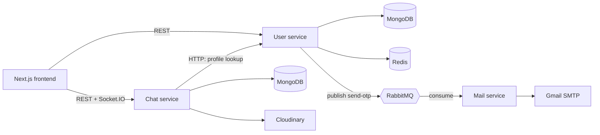

# Real-Time Chat Application

A real-time one-to-one chat application built on the MERN stack with a **microservices architecture**. Users sign in with a passwordless email OTP, chat instantly over WebSockets, and see who is online. Slow work (sending OTP emails) is pushed to a background service through a message queue so it never blocks a request.

## Features

- Passwordless login with an email OTP, followed by JWT-based sessions
- Real-time messaging with Socket.IO (instant delivery, no polling)
- Online/offline presence, typing indicators, and read receipts ("seen")
- Text and image messages (image upload through Cloudinary)
- Profile management (update display name)
- OTP rate limiting (one OTP request per minute per email) backed by Redis
- Asynchronous OTP email delivery through RabbitMQ

## Architecture



| Service | Responsibility |
|---|---|
| **User service** | OTP login, JWT issuing, user profiles, OTP storage and rate limiting in Redis, publishes email jobs to RabbitMQ |
| **Chat service** | Chats and messages (MongoDB), Socket.IO server, presence, image uploads |
| **Mail service** | Background consumer of the `send-otp` queue; sends OTP emails with Nodemailer and acknowledges only after a successful send |
| **Frontend** | Next.js app (login, OTP verification, chat UI, profile) |

Each backend service owns its own database and can be built, deployed, and restarted independently. If the Mail service is down, users can still chat and OTP jobs wait in the durable queue until it comes back.

### How the main flows work

**Login**
1. `POST /api/v1/login` checks the Redis rate-limit key, generates a 6-digit OTP, and stores it in Redis with a 5-minute TTL.
2. The User service publishes a job to the durable `send-otp` RabbitMQ queue and responds immediately.
3. The Mail service consumes the job, sends the email, then acks the message.
4. `POST /api/v1/verify` checks the OTP against Redis, creates the user on first login, and returns a JWT (15-day expiry).

**Sending a message**
1. `POST /api/v1/message` (JWT required) verifies the sender belongs to the chat and saves the message to MongoDB.
2. If the receiver is online, the Chat service pushes a `newMessage` event over Socket.IO. If not, the message is read from MongoDB the next time they open the chat.

## Tech stack

| Layer | Technology |
|---|---|
| Frontend | Next.js 16, React 19, TypeScript, Tailwind CSS 4, Socket.IO client, Axios |
| Backend | Node.js, Express 5, TypeScript |
| Real-time | Socket.IO |
| Database | MongoDB with Mongoose |
| Cache / rate limiting | Redis |
| Messaging | RabbitMQ (amqplib) |
| Email | Nodemailer (Gmail SMTP) |
| Media | Cloudinary, Multer |
| Auth | JSON Web Tokens |

## Project structure

```
.
├── backend/
│   ├── user/    # auth, profiles, OTP, RabbitMQ producer
│   ├── chat/    # messages, Socket.IO, Cloudinary uploads
│   └── mail/    # RabbitMQ consumer, email sending
└── frontend/    # Next.js app
```

## API reference

### User service (`/api/v1`)

| Method | Endpoint | Auth | Description |
|---|---|---|---|
| POST | `/login` | No | Request an OTP for an email |
| POST | `/verify` | No | Verify the OTP and receive a JWT |
| GET | `/me` | Yes | Current user's profile |
| GET | `/user/all` | Yes | List all users |
| GET | `/user/:id` | No | Get one user (used by the Chat service) |
| POST | `/update/user` | Yes | Update display name |

### Chat service (`/api/v1`)

| Method | Endpoint | Auth | Description |
|---|---|---|---|
| POST | `/chat/new` | Yes | Create a chat with another user |
| GET | `/chat/all` | Yes | List the current user's chats |
| POST | `/message` | Yes | Send a text or image message (multipart for images) |
| GET | `/message/:chatId` | Yes | Fetch a chat's messages |

Authenticated requests send the token as `Authorization: Bearer <token>`.

### Socket.IO events

The client connects to the Chat service with `userId` in the handshake query.

| Direction | Event | Purpose |
|---|---|---|
| Client → server | `joinChat`, `leaveChat` | Join or leave a chat room |
| Client → server | `typing`, `stopTyping` | Typing indicators |
| Server → client | `getOnlineUser` | List of online user IDs |
| Server → client | `newMessage` | A new message in a chat |
| Server → client | `messagesSeen` | Messages were read |
| Server → client | `userTyping`, `userStoppedTyping` | Typing indicator updates |

## Design decisions

- **Why microservices?** Fault isolation and independent deployment. Mail outages don't affect login or chat, and each service scales on its own.
- **Why RabbitMQ for OTP email?** Sending email over SMTP is slow and unreliable. Publishing a job takes milliseconds, so the login request returns immediately, and a durable queue with manual acks means a crash mid-send causes a retry, not a lost email. RabbitMQ's one-consumer-per-message task queue fits this better than Kafka's replayable log.
- **Why Redis for OTPs?** OTPs are short-lived and write-heavy. Redis TTLs expire them automatically with no cleanup job, and lookups are a single in-memory `GET`.
- **Why REST for sending and Socket.IO for delivery?** Sending needs a clear success or error response; pushing new messages to clients needs the server to initiate.

## Known limitations and roadmap

- [ ] Authenticate the Socket.IO handshake with the JWT instead of a plain `userId`
- [ ] Horizontal scaling of the Chat service (Socket.IO Redis adapter and a shared user-to-socket map)
- [ ] Paginate message history (cursor-based)
- [ ] Refresh tokens and token revocation
- [ ] Containerize each service with Docker and add a Compose file
- [ ] Retry and dead-letter handling for the OTP queue
- [ ] Automated tests

## Author

**Gulshan Kumar Dhakad** — [@GulshanKumarDhakad](https://github.com/GulshanKumarDhakad)
